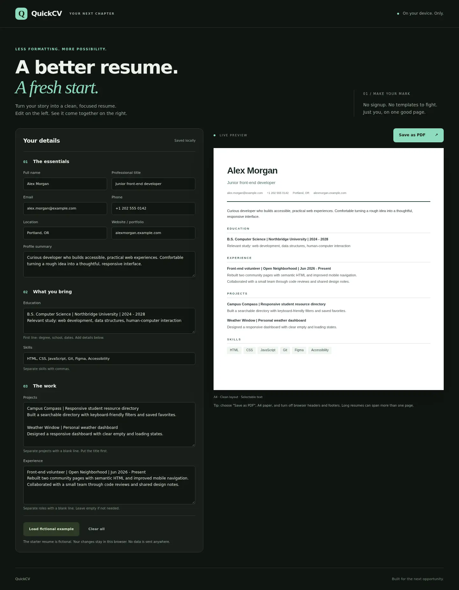
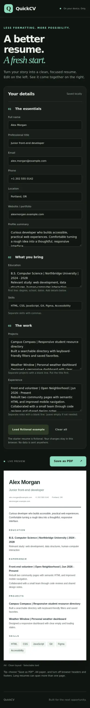

# QuickCV
### Your next chapter, on one good page.

[Open QuickCV](https://kanishksaini-007.github.io/QuickCV/) · [Source code](https://github.com/KanishkSaini-007/QuickCV)
A private, no-signup resume studio with live preview and browser-native PDF export. An editorial forest-and-mint workspace surrounds a clean white resume, with a responsive editor that works on phones too.



## Features
- Live preview for contact details, summary, education, experience, projects and skills.
- Local saving as you type, with a visible warning if storage is unavailable.
- Clean A4 print stylesheet. Use **Save as PDF** in your browser's print dialog.
- Empty sections disappear automatically. Separate projects and roles with blank lines.
- Clear all and load-example controls ask before replacing your work.
- Plain text rendering, not injected HTML. No external scripts, fonts, analytics or services.
- Keyboard focus styles, real form labels and a stacked mobile layout.

## Use it
Download or clone the repository, then open `index.html`. No installation or build is needed. You can also serve the folder with any static server.

1. Replace the fictional Alex Morgan example with your details.
2. Use commas between skills and blank lines between projects or roles.
3. Select **Save as PDF**, choose an A4 page, and disable browser headers/footers.
4. Review the browser's print preview before saving. The supplied example fits one A4 page. Longer content flows onto additional pages rather than being cut off. Keep the content focused if you want a one-page resume.

All starter names, organizations, qualifications and contact details are fictional. This is a formatting tool, not a claim that the sample achievements are yours.

## Privacy and storage
The app does not upload your information. Details are saved under `quickcv.v1` in this browser's local storage. Clearing site data removes the saved copy. Storage is not encrypted, does not sync, and is not a backup. On shared devices, clear your details when finished. File-URL storage behavior varies by browser; a static server or the hosted app is more consistent.

## Screenshots
Actual Chromium screenshots, not mockups. Desktop at 1440px and mobile at 390px.



## Test
With Node.js installed:

```sh
node core.test.cjs
```

Six assertions cover whitespace handling, omitted sections, skill splitting, required-name validation and fictional sample data. Browser QA also checked live preview, reload persistence, HTML treated as text, export validation, zero horizontal overflow at 320px and 390px, and no uncaught errors. The print output was exported, visually inspected, and verified as one A4 page for the starter content.

## Project map
- `index.html`: semantic editor and preview shell
- `style.css`: responsive forest-and-mint theme and A4 print styles
- `core.js`: pure parsing and validation helpers
- `app.js`: DOM rendering, local saving and print action
- `core.test.cjs`: dependency-free helper tests

Built with HTML, CSS and vanilla JavaScript. No runtime dependencies.
